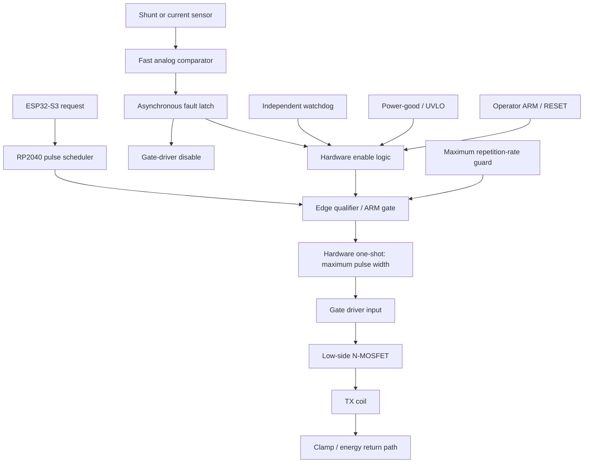

# مواصفة قفل أمان TX المستقل — Rev A

**الحالة:** مواصفة وظيفية على مستوى الكتل؛ ليست مخططاً كهربائياً معتمداً أو تعليمات توصيل.  
**التاريخ:** 2026-11-18  
**الفرع:** `hardware/rev-a-measurement-design`

## 1. الهدف

منع أي نبضة TX غير مقصودة أو أطول من الحد المسموح، حتى لو تجمد ESP32-S3 أو RP2040 أو أعاد التشغيل أو تعطلت مهمة البرنامج. يجب أن يكون الإطفاء النهائي للبوابة مفروضاً عتادياً، لا يعتمد على وصول أمر STOP عبر UART أو Wi-Fi.

## 2. بنية الكتل المطلوبة

لا يجوز أن يستطيع البرنامج تجاوز one-shot أو current comparator أو fault latch. RP2040 يطلب النبضة فقط؛ العتاد يحدد أقصى عرضها ويستطيع قطعها فوراً.

## 3. شروط السماح بالنبضة

تكون إشارة السماح الفعلية منخفضة افتراضياً، ولا ترتفع إلا إذا تحققت جميع الشروط:

- تغذية القدرة ضمن نافذة Power-Good/UVLO.
- سائق البوابة وتغذيته صالحان.
- إشارة ARM عتادية صريحة موجودة.
- watchdog مستقل يثبت أن المتحكم ما زال يستجيب.
- لا يوجد fault latched.
- التيار أقل من حد القطع قبل بدء النبضة.
- انتهى زمن منع إعادة التشغيل/الفترة الدنيا السابقة.
- لا توجد نبضة أخرى فعالة.

أي شرط مفقود = MOSFET OFF.

## 4. تسلسل النبضة

1. يرسل البرنامج طلباً منطقياً فقط، ولا يقود بوابة MOSFET مباشرة.
2. يتحقق hardware qualifier من ARM وPower-Good وwatchdog وfault state وcooldown.
3. يطلق one-shot نبضة محددة العتاد؛ لا يمكن تمديدها بإبقاء دخل الطلب HIGH.
4. يراقب comparator تيار الملف طوال النبضة.
5. عند تجاوز حد التيار، يقطع gate driver بصورة غير متزامنة ويلتقط fault latch.
6. عند انتهاء one-shot تنخفض البوابة مهما كانت حالة البرنامج.
7. يمنع repetition guard نبضة جديدة قبل انقضاء الفترة الدنيا.
8. لا يُمسح fault latch تلقائياً؛ يلزم STOP ثم تحقق من زوال السبب ثم إعادة ARM صريحة.

## 5. أوضاع الفشل وحالة الخرج

| الحالة | سلوك العتاد المطلوب |
|---|---|
| إقلاع أو Reset لأي متحكم | Gate OFF، لا نبضة تلقائية |
| انقطاع heartbeat / watchdog timeout | Gate driver disabled |
| overcurrent comparator trip | قطع فوري + fault latch |
| one-shot timeout | Gate OFF حتى لو ظل الطلب مرتفعاً |
| Power-Good/UVLO غير صالح | Gate OFF |
| fault latch set | تجاهل جميع طلبات START |
| فقد سلك ARM أو دخله عائم | Gate OFF بمقاومة افتراضية |
| STOP أو زر إيقاف | قطع غير متزامن، ثم تفريغ آمن |
| إعادة تشغيل البرنامج بعد fault | لا إعادة ARM تلقائية |

## 6. غلاف أول اختبار — حدود تصميمية غير معتمدة

الأرقام التالية هي سقف سيناريو أولي للمراجعة، وليست إعداد تشغيل أو قيم مكونات نهائية:

- مصدر TX افتراضي: 12V.
- أقصى عرض نبضة أولي: 20µs.
- أقصى معدل تكرار أولي: 100Hz (فترة لا تقل عن10ms).
- حد تيار عتادي مبدئي للدراسة: 3A؛ يجب أن يراجع مقابل تفاوت الملف، ودرجة الحرارة، ودقة القياس، وزمن comparator وturn-off overshoot.
- يجب أن يكون one-shot أقل أو مساوياً لحد20µs حتى إذا طلب البرنامج زمناً أطول.
- يجب أن يقطع comparator قبل تجاوز SOA أو حدود الملف أو المسار النحاسي.

لا يثبت هذا الغلاف أن الملف الحالي يستطيع العمل عند هذه القيم. لا يوصل ملف البحث حتى يُغلق تصميم clamp ويُختبر حمل بديل محدود التيار.

## 7. اختيار موضع قياس التيار

تظل المقارنة مفتوحة بين:
- shunt low-side مع Kelvin sense؛ بسيط نسبياً لكن يجب تحليل source bounce وتأثيره على VGS وقياس التيار.
- shunt high-side مع current-sense amplifier/comparator؛ يحافظ على source reference لكن يحتاج common-mode/سرعة مناسبة.
- current transformer أو Hall؛ لا يفترض أنه يعطي استجابة DC أو نبضية مناسبة دون التحقق من bandwidth وdroop وsaturation.

لا تثبت قيمة الشنت قبل اختيار comparator threshold والضوضاء وزمن الاستجابة وهبوط الجهد والطاقة. العلاقة المرجعية: `R_SHUNT = V_TRIP / I_LIMIT`، لكنها ليست اختياراً لقيمة بعينها.

## 8. بوابات التحقق قبل PCB

1. رسم schematic منفصل لقفل الأمان مع جدول truth table.
2. تحليل زمن comparator + latch + driver turn-off، وإثبات أن القطع يسبق SOA limit.
3. إثبات أن one-shot لا يعاد تشغيله من دخل عالق HIGH، وأنه لا يتجاوز20µs في أسوأ تفاوت.
4. إثبات حد الفترة الدنيا بين النبضات.
5. إثبات أن Reset وفقد التغذية وانقطاع heartbeat تؤدي إلى Gate OFF.
6. اختبار كل حالات fault دون ملف البحث، ثم على حمل بديل محدود التيار.
7. قياس VGS وVDS وتيار الحمل بأدوات ومجسات مناسبة، مع حساب overshoot.
8. فقط بعد نجاح ذلك، دمج الدائرة مع ملف البحث منخفض الطاقة.

## 9. حدود الإثبات

- هذه وثيقة متطلبات عتادية، وليست دائرة تم بناؤها أو اختبارها.
- لا يوجد حالياً MOSFET أو gate driver أو comparator أو one-shot أو shunt معتمد.
- GPIO GP4 الحالي خرج اختبار منطقي فقط؛ يمنع توصيله ببوابة driver أو ملف.
- أمر START في Firmware مرفوض عمداً حتى يكتمل interlock حقيقي.
- لا يجوز اعتبار software watchdog أو شرط في C code بديلاً عن القفل العتادي المستقل.

## 10. مراجع التصميم

- Nexperia AN90001: Designing in MOSFETs for safe and reliable gate-drive operation.
- Nexperia AN10273: Power MOSFET single-shot and repetitive avalanche ruggedness rating.
- Nexperia AN11158: Understanding power MOSFET data sheet parameters and SOA.
- TI SNVAA45: Driving inductive loads and clamp-voltage trade-off.
- روابط المصادر مثبتة في `COIL_TOPOLOGY_STUDY_AR.md` القسم7.14.
