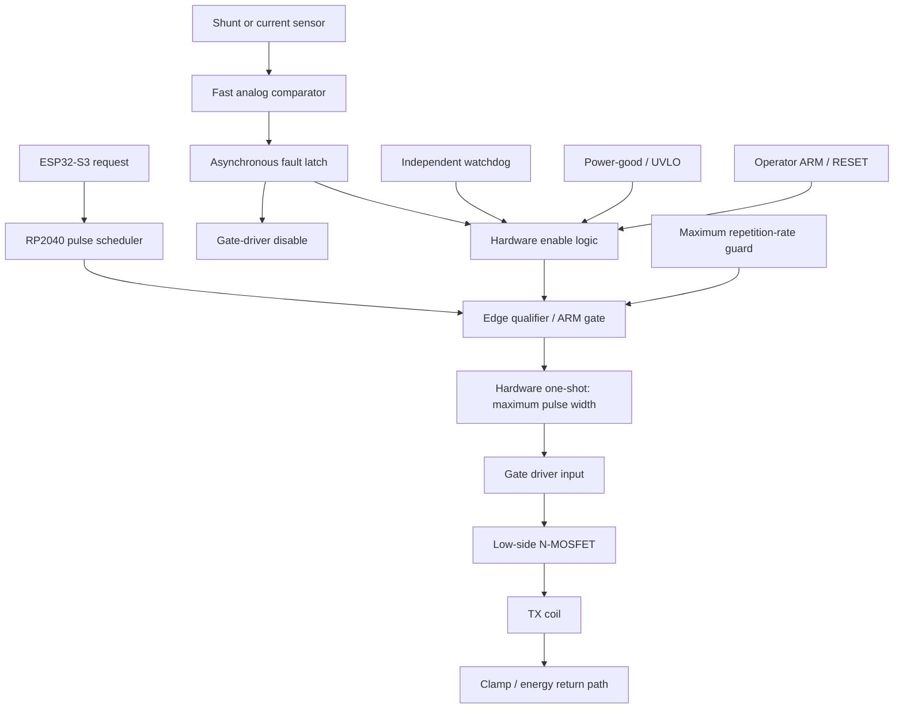

# مواصفة قفل أمان TX المستقل — Rev A

**الحالة:** مواصفة وظيفية على مستوى الكتل؛ ليست مخططاً كهربائياً معتمداً أو تعليمات توصيل.  
**التاريخ:** 2026-11-18  
**الفرع:** `hardware/rev-a-measurement-design`

## 1. الهدف

منع أي نبضة TX غير مقصودة أو أطول من الحد المسموح، حتى لو تجمد ESP32-S3 أو RP2040 أو أعاد التشغيل أو تعطلت مهمة البرنامج. يجب أن يكون الإطفاء النهائي للبوابة مفروضاً عتادياً، لا يعتمد على وصول أمر STOP عبر UART أو Wi-Fi.

## 2. بنية الكتل المطلوبة

لا يجوز أن يستطيع البرنامج تجاوز one-shot أو current comparator أو fault latch. RP2040 يطلب النبضة فقط؛ العتاد يحدد أقصى عرضها ويستطيع قطعها فوراً.

## 3. شروط السماح بالنبضة

تكون إشارة السماح الفعلية منخفضة افتراضياً، ولا ترتفع إلا إذا تحققت جميع الشروط:

- تغذية القدرة ضمن نافذة Power-Good/UVLO.
- سائق البوابة وتغذيته صالحان.
- إشارة ARM عتادية صريحة موجودة.
- watchdog مستقل يثبت أن المتحكم ما زال يستجيب.
- لا يوجد fault latched.
- التيار أقل من حد القطع قبل بدء النبضة.
- انتهى زمن منع إعادة التشغيل/الفترة الدنيا السابقة.
- لا توجد نبضة أخرى فعالة.

أي شرط مفقود = MOSFET OFF.

## 4. تسلسل النبضة

1. يرسل البرنامج طلباً منطقياً فقط، ولا يقود بوابة MOSFET مباشرة.
2. يتحقق hardware qualifier من ARM وPower-Good وwatchdog وfault state وcooldown.
3. يطلق one-shot نبضة محددة العتاد؛ لا يمكن تمديدها بإبقاء دخل الطلب HIGH.
4. يراقب comparator تيار الملف طوال النبضة.
5. عند تجاوز حد التيار، يقطع gate driver بصورة غير متزامنة ويلتقط fault latch.
6. عند انتهاء one-shot تنخفض البوابة مهما كانت حالة البرنامج.
7. يمنع repetition guard نبضة جديدة قبل انقضاء الفترة الدنيا.
8. لا يُمسح fault latch تلقائياً؛ يلزم STOP ثم تحقق من زوال السبب ثم إعادة ARM صريحة.

## 5. أوضاع الفشل وحالة الخرج

| الحالة | سلوك العتاد المطلوب |
|---|---|
| إقلاع أو Reset لأي متحكم | Gate OFF، لا نبضة تلقائية |
| انقطاع heartbeat / watchdog timeout | Gate driver disabled |
| overcurrent comparator trip | قطع فوري + fault latch |
| one-shot timeout | Gate OFF حتى لو ظل الطلب مرتفعاً |
| Power-Good/UVLO غير صالح | Gate OFF |
| fault latch set | تجاهل جميع طلبات START |
| فقد سلك ARM أو دخله عائم | Gate OFF بمقاومة افتراضية |
| STOP أو زر إيقاف | قطع غير متزامن، ثم تفريغ آمن |
| إعادة تشغيل البرنامج بعد fault | لا إعادة ARM تلقائية |

## 6. غلاف أول اختبار — حدود تصميمية غير معتمدة

الأرقام التالية هي سقف سيناريو أولي للمراجعة، وليست إعداد تشغيل أو قيم مكونات نهائية:

- مصدر TX افتراضي: 12V.
- أقصى عرض نبضة أولي: 20µs.
- أقصى معدل تكرار أولي: 100Hz (فترة لا تقل عن10ms).
- حد تيار عتادي مبدئي للدراسة: 3A؛ يجب أن يراجع مقابل تفاوت الملف، ودرجة الحرارة، ودقة القياس، وزمن comparator وturn-off overshoot.
- يجب أن يكون one-shot أقل أو مساوياً لحد20µs حتى إذا طلب البرنامج زمناً أطول.
- يجب أن يقطع comparator قبل تجاوز SOA أو حدود الملف أو المسار النحاسي.

لا يثبت هذا الغلاف أن الملف الحالي يستطيع العمل عند هذه القيم. لا يوصل ملف البحث حتى يُغلق تصميم clamp ويُختبر حمل بديل محدود التيار.

## 7. اختيار موضع قياس التيار

تظل المقارنة مفتوحة بين:
- shunt low-side مع Kelvin sense؛ بسيط نسبياً لكن يجب تحليل source bounce وتأثيره على VGS وقياس التيار.
- shunt high-side مع current-sense amplifier/comparator؛ يحافظ على source reference لكن يحتاج common-mode/سرعة مناسبة.
- current transformer أو Hall؛ لا يفترض أنه يعطي استجابة DC أو نبضية مناسبة دون التحقق من bandwidth وdroop وsaturation.

لا تثبت قيمة الشنت قبل اختيار comparator threshold والضوضاء وزمن الاستجابة وهبوط الجهد والطاقة. العلاقة المرجعية: `R_SHUNT = V_TRIP / I_LIMIT`، لكنها ليست اختياراً لقيمة بعينها.

## 8. بوابات التحقق قبل PCB

1. رسم schematic منفصل لقفل الأمان مع جدول truth table.
2. تحليل زمن comparator + latch + driver turn-off، وإثبات أن القطع يسبق SOA limit.
3. إثبات أن one-shot لا يعاد تشغيله من دخل عالق HIGH، وأنه لا يتجاوز20µs في أسوأ تفاوت.
4. إثبات حد الفترة الدنيا بين النبضات.
5. إثبات أن Reset وفقد التغذية وانقطاع heartbeat تؤدي إلى Gate OFF.
6. اختبار كل حالات fault دون ملف البحث، ثم على حمل بديل محدود التيار.
7. قياس VGS وVDS وتيار الحمل بأدوات ومجسات مناسبة، مع حساب overshoot.
8. فقط بعد نجاح ذلك، دمج الدائرة مع ملف البحث منخفض الطاقة.

## 9. حدود الإثبات

- هذه وثيقة متطلبات عتادية، وليست دائرة تم بناؤها أو اختبارها.
- لا يوجد حالياً MOSFET أو gate driver أو comparator أو one-shot أو shunt معتمد.
- GPIO GP4 الحالي خرج اختبار منطقي فقط؛ يمنع توصيله ببوابة driver أو ملف.
- أمر START في Firmware مرفوض عمداً حتى يكتمل interlock حقيقي.
- لا يجوز اعتبار software watchdog أو شرط في C code بديلاً عن القفل العتادي المستقل.

## 10. مراجع التصميم

- Nexperia AN90001: Designing in MOSFETs for safe and reliable gate-drive operation.
- Nexperia AN10273: Power MOSFET single-shot and repetitive avalanche ruggedness rating.
- Nexperia AN11158: Understanding power MOSFET data sheet parameters and SOA.
- TI SNVAA45: Driving inductive loads and clamp-voltage trade-off.
- روابط المصادر مثبتة في `COIL_TOPOLOGY_STUDY_AR.md` القسم7.14.

## 11. زمن استجابة overcurrent وovershoot — تحليل أولي

أضيفت `current_limit_response()` إلى النموذج لحساب زمن وصول التيار إلى عتبة comparator ثم الزيادة الإضافية خلال زمن comparator + latch + gate-driver turn-off. يبقى one-shot مستقلاً ويقطع عند الحد الأقصى حتى لو تأخر comparator.

**مثال حسابي فقط:** مصدر12V، L=50µH، R=0.9Ω، عتبة3A، أقصى نبضة20µs:

| تأخير القطع بعد العتبة | التيار النظري عند القطع |
|---:|---:|
| 0.1µs | 3.019A |
| 0.5µs | 3.093A |
| 1µs | 3.184A |
| 2µs | 3.365A |
| 5µs | 3.889A |

يصل التيار إلى3A بعد نحو14.16µs. إذا طال تأخير comparator+logic+driver، يستمر التيار بالصعود؛ وإذا انتهى one-shot عند20µs أولاً، فإنه يقطع مستقلاً. في حالة L=180µH/R=0.9Ω لا تصل النبضة12V/20µs إلى3A أصلاً (نحو1.27A فقط)، لذا يجب ألا تفسر هذه الحالة على أنها عتبة حماية مناسبة للملف النهائي قبل قياس L وتحديد أسوأ حالة قصر/تغير.

**متطلبات التصميم:** زمن الاستجابة الكلي يجب أن يثبت بالـdatasheets والقياس، ويُحسب overshoot الناتج عنه. لا نختار comparator أو shunt من عتبة3A فقط؛ يجب إدخال offset، noise, blanking، propagation delay، gate turn-off، وتفاوت L/R. هذا نموذج RL لا يشمل L الأسلاك والـdi/dt الطفيلي.

## 12. مرشح comparator والشنت — TLV3201

أضيفت وثيقة `REV_A_TX_CURRENT_LIMIT_CANDIDATES_AR.md` لتقييم TLV3201 من TI: 40ns typical/55ns max propagation في شروط الداتا شيت، offset max4mV عبر−40..125°C، common-mode يمتد200mV خارج القضبان، وتغذية2.7–5.5V. تمت مقارنته بـTLV3501 الأسرع4.5ns لكن offset max6.5mV واستهلاك أعلى؛ TLV3201 أفضل مبدئياً لعتبة تيار منخفضة لأن offset أهم من عدة نانوثوانٍ إضافية.

مثال دراسة فقط: 50mΩ low-side Kelvin shunt وعتبة150mV عند3A. مع offset±4mV وشنت±1% يصبح trip النظري نحو2.89–3.11A قبل ضوضاء المرجع والـlayout. لا يعتمد comparator أو الشنت بعد؛ يجب مراجعة source bounce وزمن latch/driver وقياس الاستجابة الكاملة.

## 13. مرشح one-shot مستقل — LTC6993-1 — 2026-11-18

أضيفت REV_A_TX_ONESHOT_CANDIDATES_AR.md. مرشح A هو LTC6993-1 rising-edge non-retriggerable. إعداد أولي: 3.3V، DIVCODE1/POL0/NDIV8، RSET118kΩ 1%، ومقسم DIV من976kΩ/102kΩ 1%. المعادلة تعطي18.88µs nominal؛ مع±4.4% max للدائرة و±1% للمقاومة، أعلى تقدير≈19.91µs، دون سقف20µs.

خرج المؤقت لا يقود Gate؛ يمر عبر AND gating إلى TC4420 IN مع ARM_OK وPOWER_GOOD وWATCHDOG_OK وNOT_FAULT. Fault latch يجب أن يقطع فوراً. تأخير بدء تشغيل المؤقت typ0.5–8ms ويجب حجب ARM حتى استقرار المؤقت.

**قيد مفتوح:** LTC6993-1 لا يضمن وحده فترة تكرار10ms؛ يلزم hardware repetition guard مستقل قبل السماح بنبضة جديدة. لا شراء أو تشغيل قبل إغلاق هذا القفل واختبار عرض النبضة.

## 14. تحديث repetition guard — بنية ثلاثة مؤقتات — 2026-11-18
- لتحمل stuck-high منفرد في one-shot، تقترح البنية وحدتين LTC6993-1 مستقلتين U3A/U3B، كل واحدة تضبط18.88µs nominal (RSET118kΩ1%، DIVCODE1/NDIV8، divider976kΩ/102kΩ1%). SHOT_WINDOW = U3A_OUT AND U3B_OUT؛ فشل أي واحدة LOW يمنع TX، وفشل واحدة HIGH يترك الأخرى تحد النافذة.
- U4 هو LTC6993-4 falling-edge retriggerable، يأخذ الحافة الهابطة لـSHOT_WINDOW ويولد COOLDOWN_OUT. إعداد DIVCODE4/NDIV4096، RSET127kΩ1%، divider1.00MΩ/392kΩ1%؛ nominal10.40384ms، minimum حسابي≈10.06ms بعد ±2.3% و±1%.
- TX_DRIVER_IN = SHOT_WINDOW AND NOT(COOLDOWN_OUT) AND ARM_OK AND POWER_GOOD AND WATCHDOG_OK AND NOT_FAULT.
- كل محاولة أثناء cooldown تُحجب؛ الحافة الهابطة لـSHOT_WINDOW تعيد تشغيل U4 وتبقي القفل10ms بعد آخر محاولة.
- ما زال fail-safe عند فشل U4 أو AND gate مفتوحاً؛ يجب أن يؤدي فقد صلاحية/تغذية U4 إلى TX OFF. startup inhibit لكل المؤقتات مطلوب.
- هذه بنية مقترحة لتحمل عطل stuck-high منفرد في U3A أو U3B فقط، وليست ضماناً ضد فشل مزدوج أو فشل بوابة القيادة. لا تشغيل/شراء قبل مراجعة fault injection والقياس.
