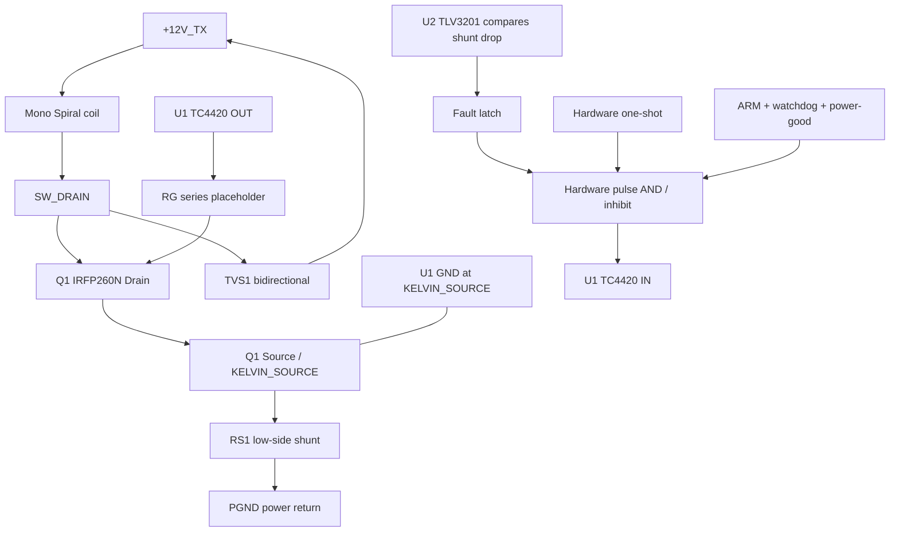

# مخطط كتل/شبكة مرحلة TX — Rev A

**الحالة:** مسودة pin-level وظيفية للمرشحين؛ لا تستخدم للتوصيل أو تصنيع PCB.  
**التاريخ:** 2026-11-18  
**الفرع:** `hardware/rev-a-measurement-design`

## 1. المرشحون المشار إليهم

- Q1: مرشحان قيد المقارنة: TI CSD19531KCS (مرشح A منخفض Qg/100V) وInfineon IRFP260NPbF (مرشح B/200V). لا اختيار نهائي قبل VDS overshoot وSOA.
- U1: TC4420، مرشح Gate Driver فقط.
- U2: TLV3201، مرشح comparator فقط.
- RS1: شنت low-side 50mΩ مثال حسابي، غير معتمد.
- TVS1: ثنائي TVS ثنائي الاتجاه (bidirectional) عبر الملف كخيار مرشح أولي؛ SMBJ18CA مرشح دراسة فقط، وليس اختيار شراء. لا تستخدم TVS أحادي الاتجاه مباشرة بهذه الوصلة.
- U3: hardware one-shot + fault latch + repetition guard؛ المكونات غير محددة.

تفاصيل الداتا شيت والقيود في:
- `REV_A_TX_POWER_STAGE_CANDIDATES_AR.md`
- `REV_A_TX_CURRENT_LIMIT_CANDIDATES_AR.md`
- `REV_A_TX_INTERLOCK_SPEC_AR.md`

## 2. مسار القدرة المقترح للمراجعة

**تصحيح جوهري لفرع clamp:** النسخة السابقة التي وضعت TVS أحادي الاتجاه مباشرة بين SW_DRAIN و+12V_TX كانت خاطئة؛ إذ تنحاز أمامياً أثناء نبضة TX العادية ويمكن أن تقصر التغذية. في هذه المسودة يُرسم TVS ثنائي الاتجاه عبر طرفي الملف دون قطبية ثابتة، ويجب أن يكون VRWM أعلى من أقصى جهد تشغيل عادي للملف مع هامش. المرشح SMBJ18CA (VRWM=18V) للدراسة فقط مع مصدر اسمي12V؛ لا شراء قبل التحقق من حد المصدر الفعلي ومنحنى V-I والطاقة المتكررة. البديل TVS أحادي الاتجاه لا يجوز وصله مباشرة؛ يحتاج blocking diode على التوالي في فرع clamp وفق مرجع TI، مع التحقق من اتجاهه وVF وIF/VRRM.

## 3. Net-level connection draft

| الشبكة | الاتصال | الحالة |
|---|---|---|
| +12V_TX | موجب مصدر TX وطرف الملف الأول؛ الطرف الثاني لفرع TVS1 ثنائي الاتجاه | افتراضي |
| COIL_LOW / SW_DRAIN | طرف الملف الثاني وDrain Q1؛ TVS1 ثنائي الاتجاه بينه وبين +12V_TX | افتراضي |
| KELVIN_SOURCE | Source Q1، رجوع U1 GND، sense high RS1 | يحتاج تخطيط Kelvin |
| PGND | طرف RS1 المنخفض، سالب مصدر TX | قدرة |
| GATE_RAW | خرج TC4420 عبر RG إلى Gate Q1 | RG غير محدد |
| GATE_SOURCE | مقاومة pulldown بين Gate وSource Q1 | القيمة غير محددة |
| SHUNT_SENSE_P | طرف RS1 العلوي عند Source Q1، إلى U2 IN+ | Kelvin trace |
| SHUNT_SENSE_N | طرف RS1 السفلي عند PGND؛ مرجع أرضي قياس الشنت وI_LIMIT_REF | Kelvin trace |
| I_LIMIT_REF | جهد العتبة المنظم (مثال150mV فقط)، إلى U2 IN− | القيمة/المرجع غير محددين |
| I_LIMIT_REF | مرجع threshold منظم إلى U2 input المقابل | القيمة/المرجع غير محددين |
| OC_FAULT | خرج U2 إلى asynchronous set في fault latch | polarity/logic غير محددين |
| TX_PERMIT | AND hardware: one-shot AND ARM_OK AND NOT_FAULT AND POWER_GOOD | LOW افتراضياً |
| DRIVER_IN | TX_PERMIT إلى TC4420 IN | لا يقاد من MCU مباشرة |
| DRIVER_VDD | 10–12V مبدئياً بالنسبة إلى KELVIN_SOURCE | يحتاج rail/decoupling |
| LOGIC_3V3/5V | تغذية U2 والـlatch والـone-shot حسب اختيارها | لم تُثبت |

## 4. نقاط يجب عدم إساءة فهمها

1. U1 GND يربط Kelvin source وليس مسار PGND بعيداً؛ الهدف تقليل common-source inductance. يجب أن يبقى مسار تيار RS1 منفصلاً عن sense trace.
2. ممنوع TVS أحادي الاتجاه مباشرة عبر الملف بهذه القطبية؛ سينحاز أمامياً عندما يكون Drain منخفضاً أثناء TX ON. استخدم bidirectional TVS بجهد stand-off أعلى من أقصى جهد الملف، أو فرع unidirectional TVS مع blocking diode متسلسل مصمم كما في مرجع TI.
3. U2 يقيس جهد الشنت الصغير قرب الأرضي. لا توصل أي مدخل comparator إلى SW_DRAIN أو طرف الملف؛ تلك عقدة قدرة عالية الجهد.
4. TC4420 لا يحتوي Enable مخصصاً. TX_PERMIT يجب أن يفرض LOW على IN، مع pull-down مستقل. comparator fault latch يجب أن يستطيع إسقاط TX_PERMIT دون انتظار البرنامج.
5. TVS1 SMBJ18CA يعطي تقديراً أولياً VCLmax≈22.5–23.0V عند1.2–2.55A من معادلة ST (RD=0.328Ω، VCL=29.2V عند21.5A). لكن المعادلة مبنية على surge 10/1000µs؛ نبضتنا أقصر، لذا يجب التحقق من Figure6/قياس V-I. احسب Drain=12V+VCL الفعلي+parasitic overshoot.
6. لا تضع TVS أو shunt أو driver على breadboard بأسلاك طويلة؛ حلقة الملف/المفتاح/clamp يجب أن تكون قصيرة جداً، والـsense/logic مفصولة عن مسار القدرة.
7. لا يُوصل GP4 مباشرة بـU1 IN أو Gate. إشارة RP2040 تمر فقط عبر one-shot وARM/fault logic بعد اكتمالها.
8. يجب أن يكون Q1 Gate pulldown فعالاً حتى عند غياب VDD أو فصل U1.

## 5. بوابات إغلاق قبل تحويل المسودة إلى KiCad

- اختيار نوع وموديل TVS أو RCD/active clamp بعد حساب VCLAMP عند التيار الفعلي ودرجة الحرارة والطاقة المتكررة.
- Q1 مرشح A للدراسة CSD19531KCS (100V، Qg max49nC، Qgd typ7.5nC) ومرشح B IRFP260NPbF (200V، Qg max234nC، Qgd max110nC). لا شراء قبل قياس VDS overshoot ومراجعة SOA. Rg لا يزال غير محدد؛ اختبر4.7/10/15Ω على حمل بديل وقارن VGS/VDS/ringing.
- اختيار shunt وthreshold reference وcomparator بعد حسم current limit وتفاوت L/R.
- اختيار U3 one-shot/fault latch واثبات non-retriggerable timeout.
- اختبار Rg=4.7/10/15Ω كقيم bench فقط، وحسابها مع Qg/Qgd وdriver output impedance، والتحقق بالراسم من VGS/VDS/ringing.
- حساب layout parasitics وVDS overshoot وقياسها على حمل بديل.
- إجراء ERC/DRC وthermal/SOA review قبل إصدار Gerbers/PCBA.

**الحالة النهائية لهذه الوثيقة:** يمكن استخدامها لتوجيه الرسم الكهربائي التالي، لكنها ليست schematic قابل للتوصيل، ولا BOM، ولا دليلاً على أن أي قطعة موجودة أو تم اختبارها.

## 6. قيد زمن Gate Driver — TC4420
- لا تستخدم55ns كحد أقصى؛ هي typical. اعتمد100ns max كحد تأخير عبر نطاق الحرارة في worst-case timing budget، مع rise/fall حتى60ns max عند2500pF.
- 6A peak قيمة typical عندVDD18V وليست minimum مضموناً. قيم ROH/ROL المنشورة مقاسة عند10mA، ولا تمثل نموذجاً كاملاً لتيار البوابة العالي.
- يجب قياس turn-off الفعلي للـMOSFET مع Rg وQgd والـlayout، وعدم جمع أرقام typ وحدها لإثبات قطع overcurrent.
