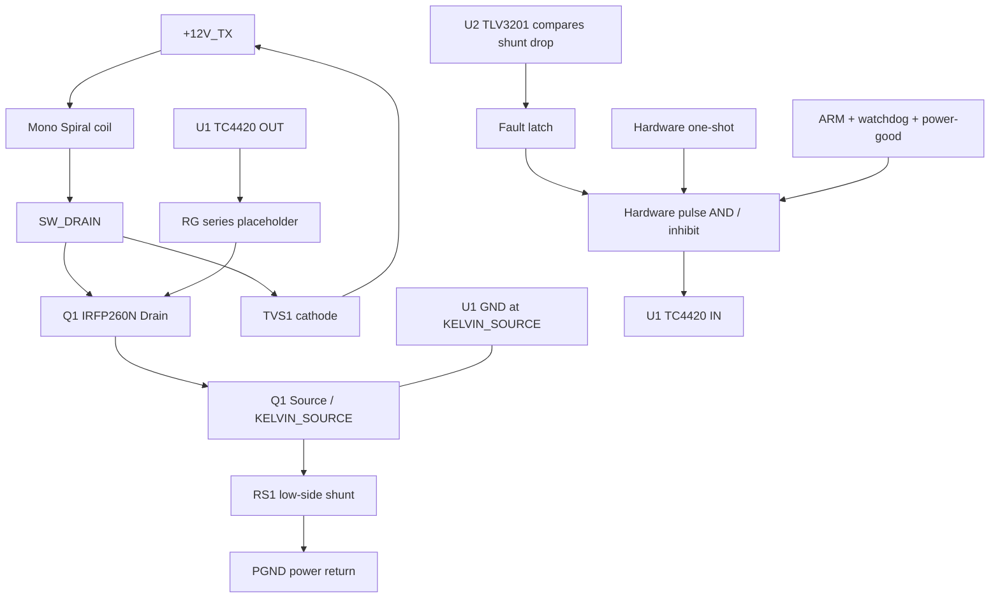

# مخطط كتل/شبكة مرحلة TX — Rev A

**الحالة:** مسودة pin-level وظيفية للمرشحين؛ لا تستخدم للتوصيل أو تصنيع PCB.  
**التاريخ:** 2026-11-18  
**الفرع:** `hardware/rev-a-measurement-design`

## 1. المرشحون المشار إليهم

- Q1: IRFP260NPbF، مرشح MOSFET فقط.
- U1: TC4420، مرشح Gate Driver فقط.
- U2: TLV3201، مرشح comparator فقط.
- RS1: شنت low-side 50mΩ مثال حسابي، غير معتمد.
- TVS1: clamp عبر الملف، رقم القطعة والجهد غير محددين.
- U3: hardware one-shot + fault latch + repetition guard؛ المكونات غير محددة.

تفاصيل الداتا شيت والقيود في:
- `REV_A_TX_POWER_STAGE_CANDIDATES_AR.md`
- `REV_A_TX_CURRENT_LIMIT_CANDIDATES_AR.md`
- `REV_A_TX_INTERLOCK_SPEC_AR.md`

## 2. مسار القدرة المقترح للمراجعة

**تفسير TVS1:** الكاثود على SW_DRAIN والأنود على +12V_TX. أثناء الإطفاء يرتفع Drain فوق +12V فيمر تيار الملف عبر TVS ليُفرغ الطاقة. هذا اتجاه مبدئي لشبكة clamp عبر الملف؛ يجب التحقق من قطبية/نوع TVS وتوصيلها الفعلي قبل اعتماد الرسم.

## 3. Net-level connection draft

| الشبكة | الاتصال | الحالة |
|---|---|---|
| +12V_TX | موجب مصدر TX، طرف الملف الأول، أنود/مرجع clamp وفق الطوبولوجيا أعلاه | افتراضي |
| COIL_LOW / SW_DRAIN | طرف الملف الثاني، Drain Q1، كاثود TVS1 | افتراضي |
| KELVIN_SOURCE | Source Q1، رجوع U1 GND، sense high RS1 | يحتاج تخطيط Kelvin |
| PGND | طرف RS1 المنخفض، سالب مصدر TX | قدرة |
| GATE_RAW | خرج TC4420 عبر RG إلى Gate Q1 | RG غير محدد |
| GATE_SOURCE | مقاومة pulldown بين Gate وSource Q1 | القيمة غير محددة |
| SHUNT_SENSE_P | طرف RS1 العلوي عند Source Q1، إلى U2 IN+ | Kelvin trace |
| SHUNT_SENSE_N | طرف RS1 السفلي عند PGND؛ مرجع أرضي قياس الشنت وI_LIMIT_REF | Kelvin trace |
| I_LIMIT_REF | جهد العتبة المنظم (مثال150mV فقط)، إلى U2 IN− | القيمة/المرجع غير محددين |
| I_LIMIT_REF | مرجع threshold منظم إلى U2 input المقابل | القيمة/المرجع غير محددين |
| OC_FAULT | خرج U2 إلى asynchronous set في fault latch | polarity/logic غير محددين |
| TX_PERMIT | AND hardware: one-shot AND ARM_OK AND NOT_FAULT AND POWER_GOOD | LOW افتراضياً |
| DRIVER_IN | TX_PERMIT إلى TC4420 IN | لا يقاد من MCU مباشرة |
| DRIVER_VDD | 10–12V مبدئياً بالنسبة إلى KELVIN_SOURCE | يحتاج rail/decoupling |
| LOGIC_3V3/5V | تغذية U2 والـlatch والـone-shot حسب اختيارها | لم تُثبت |

## 4. نقاط يجب عدم إساءة فهمها

1. U1 GND يربط Kelvin source وليس مسار PGND بعيداً؛ الهدف تقليل common-source inductance. يجب أن يبقى مسار تيار RS1 منفصلاً عن sense trace.
2. U2 يقيس جهد الشنت الصغير قرب الأرضي. لا توصل أي مدخل comparator إلى SW_DRAIN أو طرف الملف؛ تلك عقدة قدرة عالية الجهد.
3. TC4420 لا يحتوي Enable مخصصاً. TX_PERMIT يجب أن يفرض LOW على IN، مع pull-down مستقل. comparator fault latch يجب أن يستطيع إسقاط TX_PERMIT دون انتظار البرنامج.
4. TVS1 يجب أن يثبت VCLAMP الفعلي عند تيار2.5–3A، لا VRWM فقط. يجب حساب جهد Drain = 12V + VCLAMP الفعلي + parasitic overshoot.
5. لا تضع TVS أو shunt أو driver على breadboard بأسلاك طويلة؛ حلقة الملف/المفتاح/clamp يجب أن تكون قصيرة جداً، والـsense/logic مفصولة عن مسار القدرة.
6. لا يُوصل GP4 مباشرة بـU1 IN أو Gate. إشارة RP2040 تمر فقط عبر one-shot وARM/fault logic بعد اكتمالها.
7. يجب أن يكون Q1 Gate pulldown فعالاً حتى عند غياب VDD أو فصل U1.

## 5. بوابات إغلاق قبل تحويل المسودة إلى KiCad

- اختيار نوع وموديل TVS أو RCD/active clamp بعد حساب VCLAMP عند التيار الفعلي ودرجة الحرارة والطاقة المتكررة.
- اختيار shunt وthreshold reference وcomparator بعد حسم current limit وتفاوت L/R.
- اختيار U3 one-shot/fault latch واثبات non-retriggerable timeout.
- حساب gate resistance من Qg/Qgd وdriver output impedance، والتحقق من VGS ringing.
- حساب layout parasitics وVDS overshoot وقياسها على حمل بديل.
- إجراء ERC/DRC وthermal/SOA review قبل إصدار Gerbers/PCBA.

**الحالة النهائية لهذه الوثيقة:** يمكن استخدامها لتوجيه الرسم الكهربائي التالي، لكنها ليست schematic قابل للتوصيل، ولا BOM، ولا دليلاً على أن أي قطعة موجودة أو تم اختبارها.
